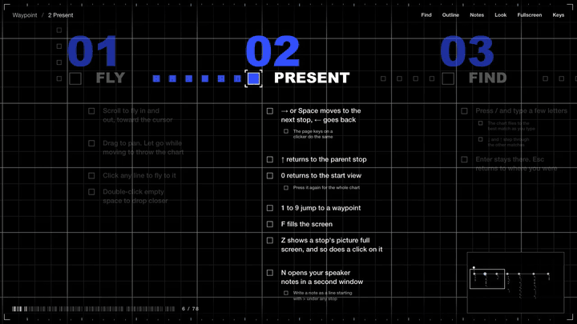
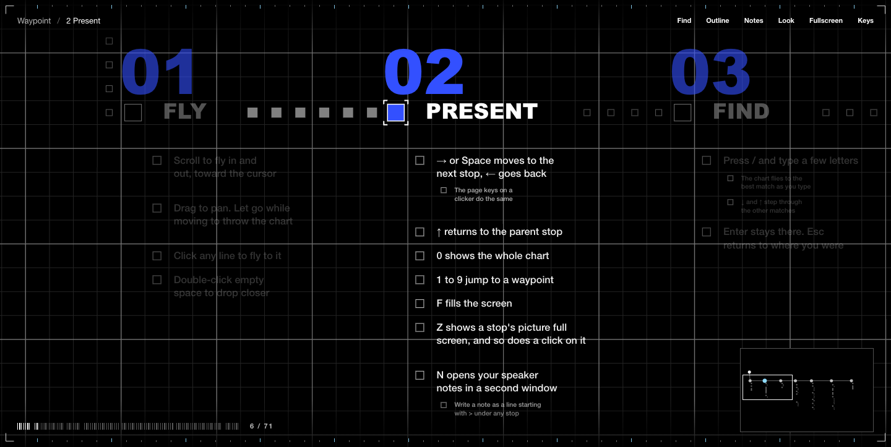
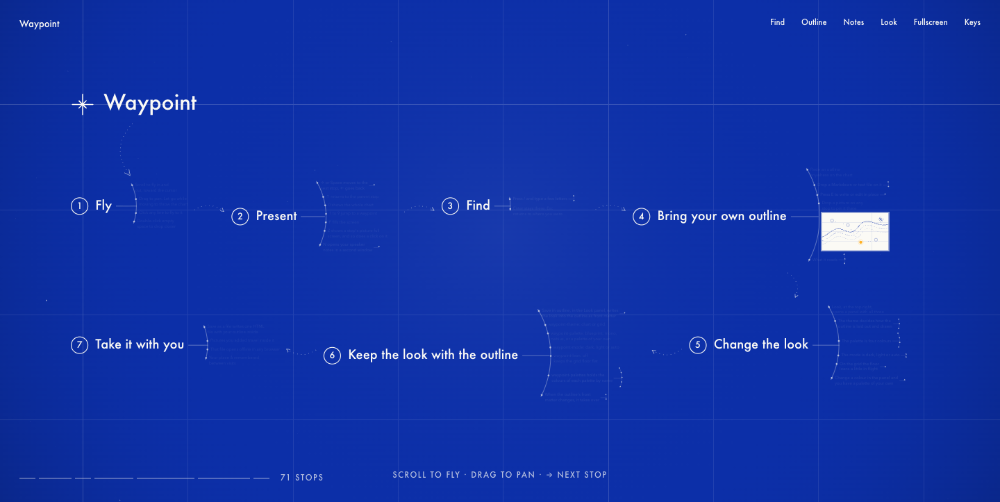
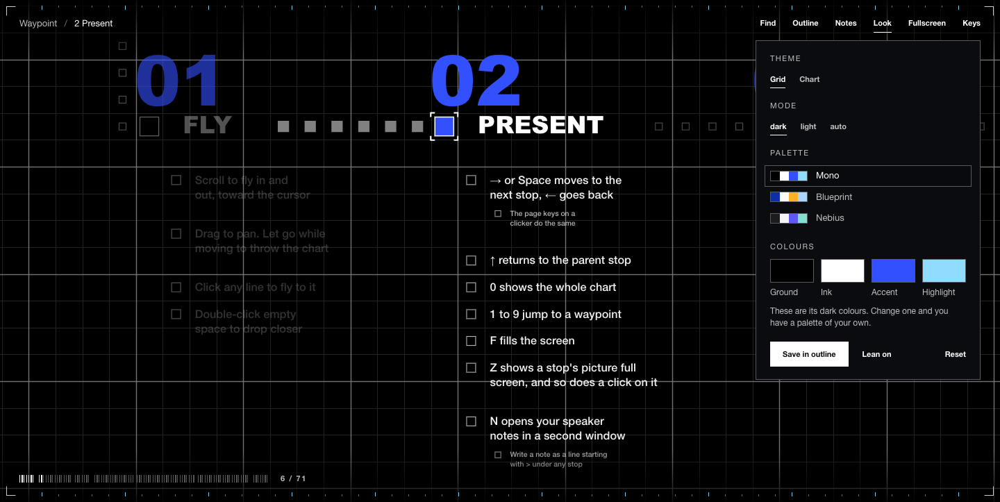

# Waypoint

Waypoint turns a Markdown outline into a chart you can fly around and present from. Headings become numbered waypoints, bullets become the points around them, and the camera moves between them as you step through.

It is one HTML file with no dependencies and no build step. The page loads nothing from the network, and your outline stays in your browser.



The animation is reduced in size and colour. [Watch it at full quality](screenshots/demo.mp4).

## Use it

Open it at [antongisli.github.io/waypoint](https://antongisli.github.io/waypoint/), or download `index.html` and open it in a browser. It works offline either way. It starts with a short guide that is itself an outline, so you can try the controls straight away.

To chart your own outline, do any of these:

- Paste an outline anywhere on the chart.
- Drop a Markdown or text file on it.
- Press `E` and write or edit in place. The editor opens beside the chart, and the chart redraws as you type.

## Outline format

```markdown
# Talk title

## First section
> A line starting with > is a speaker note. It shows only in the notes window.
- A point
  - A sub-point, nested as deep as you like
- Another point
  

## Second section
- ...
```

- Headings become numbered waypoints.
- Bullets and numbered items become points. Indentation nests them.
- A line starting with `>` or `Note:` is a speaker note for the stop above it.
- A Markdown image line pins a picture to the stop above it. You can also drop or paste a picture onto any stop.
- Front matter at the top of a file can set the look (see below). Other front matter is left alone.

## Themes, palettes and modes

The look has three parts:

- **Theme**: how the outline is laid out and drawn. *Grid*, the default, sets the outline in columns on a ruled floor that leans a little while the camera is in flight. *Chart* puts points on arcs around each waypoint and joins the waypoints with curved arrows.
- **Palette**: four colours. *Ground* is the surface, *ink* is lettering and lines, *accent* marks where you are and the route already flown, and *highlight* marks what you point at or search for. Every palette has a dark and a light version.
- **Mode**: dark, light, or auto, which follows the system setting.

Any theme can wear any palette. The built-in palettes are Mono, Blueprint and Nebius. Each theme has a default palette: Grid wears Mono and Chart wears Blueprint.





The Look button opens a panel with all three. Changing one of the four colours there makes a palette of your own, which you can rename and which is remembered in the browser. "Save in outline" writes the current look into the outline's front matter, so it travels with the file.



## Start view

By default an outline opens on the whole chart. To open somewhere else, frame the view you want (scroll to zoom, drag to pan) and press `S`, or choose This view under Start in the Look panel. The outline then opens there, `0` returns to it, and `0` a second time shows the whole chart. Whole chart, under Start, clears it.

The view is kept per outline, as a centre and a zoom relative to the whole chart, so it holds when the window changes size. A different theme, a window of a very different shape, or a large edit lays the chart out differently, and the view then frames a nearby area; set it again if that happens. "Save in outline" writes it into the front matter as `waypoint-start: view 0.234 0.256 6.5`: the centre across and down the chart, as fractions, and the zoom relative to the whole chart.

## Setting the look in front matter

```yaml
---
waypoint-theme: grid
waypoint-palette: dusk
waypoint-mode: light
waypoint-lean: off
waypoint-palettes:
  dusk:
    name: "Dusk"
    dark: { ground: "#1b1020", ink: "#fff4e6", accent: "#ff6b35", highlight: "#ffd166" }
    light: { ground: "#fff8f0", ink: "#2a1420", accent: "#c2410c", highlight: "#8a5a00" }
---
```

| Key | Values |
| --- | --- |
| `waypoint-theme` | `grid` (the default) or `chart` |
| `waypoint-palette` | the id of a built-in palette (`mono`, `blueprint`, `nebius`) or one defined under `waypoint-palettes` |
| `waypoint-mode` | `dark`, `light` or `auto` |
| `waypoint-lean` | `off` keeps the grid floor flat in flight |
| `waypoint-start` | `overview`, or `view <across> <down> <zoom>` as written by Save in outline |
| `waypoint-palettes` | palettes defined by this outline, each with `dark` and `light` colours |

All keys are optional. A palette may give only one mode; the other is then worked out from it by swapping ground and ink and adjusting the two accents until they are readable. Each mode may also give `surface`, the colour of panels; without it, the surface is worked out from the ground.

The keys are flat so that Obsidian shows them as ordinary properties. The same settings can also be nested under a single `waypoint:` key.

When an outline's front matter changes, it takes over again. Until then, a change made with the Look panel or the keys holds. Reset in the Look panel returns to what the outline says.

## Keys

| Key | Action |
| --- | --- |
| `→` or `Space` | Next stop |
| `←` | Previous stop |
| `↑` or `Esc` | Up one level |
| `0` or `Home` | Start view; press again for the whole chart |
| `S` | Make the current view the start view |
| `1` to `9` | Jump to a waypoint |
| `/` | Find a stop by typing |
| `E` | Open the editor beside the chart |
| `Esc` | In the editor, close it (Done) |
| `⌘S` or `Ctrl+S` | In the editor, save to the file being followed |
| `N` | Speaker notes in a second window |
| `F` | Fullscreen |
| `Z` | A stop's picture full screen, and back |
| `T` | Next theme |
| `P` | Next palette |
| `D` | Dark or light |
| `L` | On the grid, lean in flight off and on |

Scroll flies in and out toward the cursor, drag pans, and a click on any line flies to it. The page keys on a presentation clicker move between stops.

## Working with files

- In Chrome and Edge, a dropped file is followed: save it in your editor and the chart redraws. Edits made in Waypoint's editor are written back to the same file when you press `⌘S` or Done, not while you type. "Save in outline" writes to it as well.
- If the file changes on disk while you are editing it in Waypoint, saving stops and says so, and offers to save over it.
- Moving the caret in the editor flies the chart to that line's stop, and moving on the chart moves the caret.
- Files dragged from Obsidian's file list work once you have opened the vault folder in Waypoint.
- "Save as a file" writes a single HTML file with your outline, pictures and look inside. That file opens offline in any browser.
- Your outline and your place in it are remembered in the browser between visits.

## Adding a palette

Add an entry to `PALETTES` in `index.html`:

```js
sea: { name: 'Sea',
  dark:  { ground: '#06232b', ink: '#e8f6f3', accent: '#ffb000', highlight: '#7fd1c7' },
  light: { ground: '#f2f7f6', ink: '#06323c', accent: '#b25e00', highlight: '#0b7a70' } },
```

Check that ink on ground reaches a contrast of at least 4.5 to 1 in both modes. The Look panel warns when it does not.

## Adding a theme

A theme is one object in `THEMES`. The comment above `THEMES` in `index.html` lists what a theme provides: its lettering, how it measures and places each stop, and functions that draw the ground, the route, the marks and anything laid over the chart. The two built-in themes are each in one block, marked `THEME: chart` and `THEME: grid`. Copying one of them is the quickest way to start.

A theme does not choose colours. It draws with `ink(a)`, `acc(a)`, `hi(a)` and `gnd(a)`, which return the ink, accent, highlight and ground colours of the palette in use at opacity `a`. That is what lets every theme work with every palette in both modes.

## License

MIT. See [LICENSE](LICENSE).

## Browser support

Waypoint is developed and tested in Chrome. File following and saving back rely on the File System Access API, which is available in Chrome and Edge. Safari and Firefox have not been tested.
